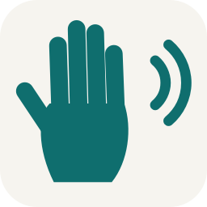
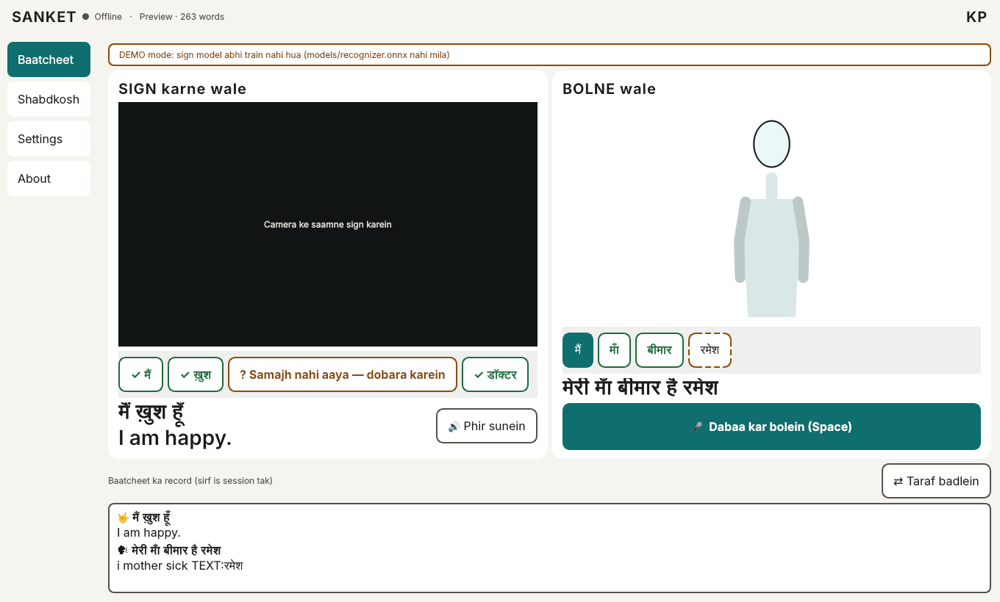
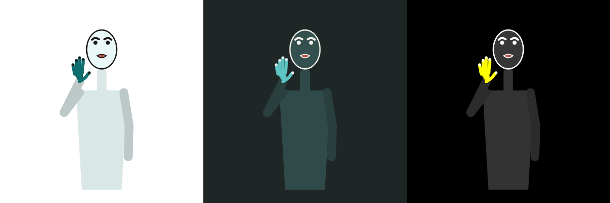

<p align="center"></p>

<h1 align="center">SANKET (संकेत)</h1>
<p align="center"><b>Offline, two-way Indian Sign Language ⇄ speech translator.</b><br>
A Deaf or mute person signs, SANKET speaks. The hearing person speaks, SANKET's avatar signs back.<br>
No internet. No account. Nothing leaves the device.</p>

<p align="center">


</p>



## Why
India has around 300 certified ISL interpreters for millions of Deaf people. At a shop counter, a bank desk or a clinic there is usually no interpreter at all. SANKET puts a small, honest translator on any Windows laptop with a webcam.

## What it does
| | |
|---|---|
| 🤟 **Sign → Voice** | Sign in front of the webcam → each sign becomes a word chip → the sentence is shown in Hindi + English and spoken aloud. |
| 🗣 **Voice → Sign** | Hold **Space** and speak Hindi or English → an avatar signs the reply in ISL word order with highlighted captions. |
| ✅ **Honest by design** | Not sure? It asks *"Samajh nahi aaya — dobara karein"* instead of guessing. Tap a chip to pick from the top-3. |
| 🔒 **Private** | Camera and audio are processed in memory only. No network code at all — tested with sockets blocked. |
| 📖 **Learn** | Dictionary of all 263 signs with 0.5× playback. |
| ♿ **Readable** | Large captions, light / dark / high-contrast, full keyboard control. |

## How it works
```
SIGN → VOICE   webcam → MediaPipe Holistic (79 points) → sign segmenter → SANKET recognizer (own model) → ISL→Hindi/English rules → Windows voice
VOICE → SIGN   mic → Vosk offline STT → Hindi/English→ISL rules → sign dictionary (real Deaf-signer motions) → 2D avatar
```
- **Own model, trained from scratch:** a ~1.9 M-parameter transformer on landmark sequences, exported to ONNX (runs in ~10 ms on a laptop CPU; same file will run on Android).
- **Avatar motions are real:** for each word the most typical recording by Deaf signers (INCLUDE) is replayed — nothing is invented.
- Full details: [`docs/HOW_IT_WORKS.md`](docs/HOW_IT_WORKS.md) · specs: [PRD](docs/PRD.md) · [TRD](docs/TRD.md) · [UI/UX](docs/UI_UX_BRIEF.md) · [Roadmap](docs/ROADMAP_AND_GATE21.md)

<p align="center"></p>

## Quick start (Windows)
```powershell
git clone https://github.com/Kanak234/SANKET; cd SANKET; .\scripts\run_full_pipeline.ps1; uv run python -m sanket
```
The pipeline downloads the INCLUDE dataset (56.8 GB, resumable), trains the recognizer on an NVIDIA GPU, builds the avatar dictionary and runs the self-test. See [`START_HERE.md`](START_HERE.md).

## v1 scope — honest limits
- **263 everyday isolated words** (INCLUDE vocabulary). Not continuous signing, no fingerspelling yet.
- A **preview**, not a replacement for an interpreter.
- Avatar signs are awaiting review by Deaf community members.

## Credits
Signs recorded by Deaf students of **St. Louis School for the Deaf, Adyar, Chennai** — INCLUDE dataset (Sridhar, Ganesan, Kumar, Khapra, ACM MM 2020), AI4Bharat / IIT Madras, CC BY 4.0. Third-party components: [`THIRD_PARTY_NOTICES.md`](THIRD_PARTY_NOTICES.md).

## Want to help?
Deaf signers, ISL teachers and developers are welcome — especially to verify signs and record regional variants. Contributions are accepted only under the [contributor agreement](docs/DATA_AND_LICENSES.md#contributor-agreement-for-friends--community-contributors).

## Licence
Copyright © 2026 Kanak Prabhakar. **All rights reserved.** Viewing this repository grants no rights to use, copy or modify it. See [`LICENSE`](LICENSE).
